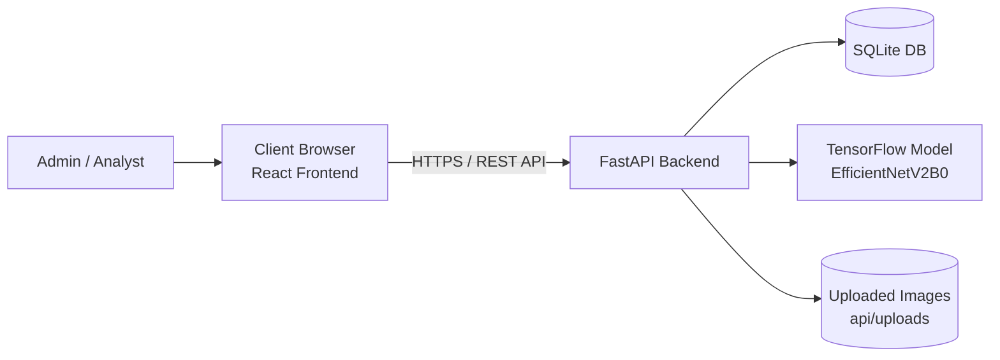

# System Architecture

## Overview

This project is a banknote recognition platform with:

- React + Vite frontend (`currency-frontend`)
- FastAPI backend (`DA_2`)
- TensorFlow model inference service (loaded in FastAPI runtime)
- SQLite database (`currency_ai.db`) for users and prediction history

## Architecture Diagram

## Main Runtime Flows

### Authentication

1. User logs in from frontend.
2. Backend validates credentials and returns JWT token + role.
3. Frontend stores token/session profile and attaches `Authorization: Bearer <token>` in API requests.
4. Protected routes (`/history`, `/dashboard`, `/model-info`, `/users`) are enforced in frontend and backend.

### Prediction

1. User uploads image from Predict page.
2. Frontend sends multipart file to `/predict`.
3. Backend validates file type/size, preprocesses image, runs model inference.
4. Backend stores prediction event into `prediction_history`.
5. Frontend shows highlighted top prediction, confidence bars, top-3 outputs, suspicious warning if low confidence.

### Analytics

1. Frontend calls `/stats`.
2. Backend aggregates history records into summary metrics and time-series data.
3. Frontend renders summary cards + pie/bar/line charts.

### History and Audit

1. Frontend calls `/history` with search/filter/pagination parameters.
2. Backend returns paginated history records.
3. Frontend supports record detail view, CSV export (`/history/export`) and PDF export in UI.

## Security and Access

- Role model: `admin`, `analyst`
- Backend-enforced admin-only APIs: user management (`/users` CRUD)
- Session indicator in UI displays active role and username
- Unauthorized requests return `401`, frontend auto-clears session and redirects to `/login`
